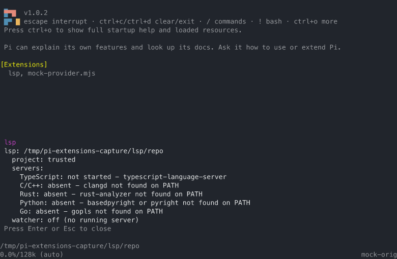

# lsp extension

Gives the agent the project's real compiler in the loop. The extension
speaks the Language Server Protocol in-process (ADR 0041) to the language
servers already on the machine or in the project's own `node_modules` -
it never installs, downloads, or builds one. Its primary job is **Post-edit diagnostics**: after an edit, the
project's Language server reports what the edit broke, and the note is
attached to the result the agent is already looking at. Navigation is a
narrow second set, taken only where a Language server clearly beats
codegraph: exact references and the real type behind a symbol. Symbol
search, file reading, and the call trail stay with codegraph (ADR 0040).
v1 is read-only: the extension never writes a file, and every write still
goes through the agent's own tools.

## Screenshot

The bare `/lsp` command over a small TypeScript fixture: the trust
decision, the Server registry with each language's state, and the watcher
state of the roots a server actually serves.



## The loop

- **Post-edit annotation.** A `tool_result` handler on the built-in `edit`
  and `write` tools reads the changed file's Diagnostics from its Language
  server and appends them after pi's stock result text, so the agent can
  still tell whether the edit succeeded. The handler runs whether or not
  the lsp tools are active, and a call nested inside another call - a
  codemode script, a bash heredoc - annotates through the same hook.
  Only Diagnostics new against the file's Diagnostic baseline are named,
  so a repo's pre-existing errors do not ride every turn.
- **Sweep.** At `turn_end`, the Open documents and the Changed set are
  re-checked. When new error-severity Diagnostics appeared - an edit made
  outside pi's edit tools, in a file the server already has open - one
  message is appended to the session. The extension requests no
  continuation: the agent reads the report at the start of its next turn,
  so a diagnostics report can never loop the session (ADR 0040).
- **Document sync.** Disk is the only truth (ADR 0042). A file enters the
  Open document set on any `read`, `edit`, `write`, or `lsp_*` call that
  names it; the set is an LRU capped at `maxOpenDocuments` per server
  (default 32), and eviction sends `didClose`. Before any answer is
  served from a document, its mtime and size are checked against the
  record and the document is re-synced when they moved, so an edit made
  by a script or another agent is picked up the same way as an edit made
  by pi's edit tool.
- **Watcher.** One recursive `fs.watch` per served root records the
  Changed set with a 1000 ms debounce; it never watches the home
  directory, and it excludes `.git`, `node_modules`, `target`, `build`,
  `dist`, `.venv`, `__pycache__`, and `.codegraph`. A watcher event is a
  signal, not proof: events can be dropped or coalesced, so the stat
  check above is the correctness gate. `LSP_NO_WATCH=1` opts out, WSL2
  `/mnt` roots are never watched, and a watcher that degrades drops to
  the fallback - a stat pass over the Open documents plus a bounded
  `git status` sweep (git worktrees only, at most 20 files, at most once
  per turn, error severity only).
- **Servers.** Lazy, one server per (language, root) pair, started by the
  first call that needs it, alive for the session, and closed
  idempotently at `session_shutdown` (ADR 0043). The root is the nearest
  marker walking up from the file - `Cargo.toml`, `go.mod`,
  `tsconfig.json` or `package.json`, `pyproject.toml`,
  `compile_commands.json` or `compile_flags.txt` - falling back to the
  session root. The Concurrent server bound of four evicts the idlest
  server and its Open documents. A crashed server restarts once and is
  then marked dead; a per-request timeout (default 20 s) names the server
  in the error.

## Tools

The tools register always and activate only when at least one server is
available for the project. A 3-line prompt note appears only then, and
states the boundary: `lsp_references` for exact call sites, `lsp_hover`
for the real type, codegraph for symbols and file reading.

| Tool | Purpose |
| --- | --- |
| `lsp_diagnostics` | The current Diagnostics of one file from its real Language server, with severities. Use it to check a file before or after touching it. Labeled partial while the server is still indexing. |
| `lsp_references` | The exact call sites of a symbol at file, line, and optional character: where grep finds text, this finds the symbol's real usages. |
| `lsp_hover` | The real type behind a symbol: the server's hover (type, signature, doc) at file, line, and optional character. |

There is no `lsp_symbols`, no `lsp_definition`, and no call hierarchy:
codegraph owns symbol search, file reading, and the call trail.

## What reaches the model

Stock result text first, then Diagnostics grouped by file: the edited file
always, plus any Open document whose Diagnostics changed. Severity error
and warning, hint suppressed by default. Only Diagnostics new against the
file's Diagnostic baseline. At most 10 per file and 30 per result, then
one summary line (`+14 more in crates/parser/src/parse.rs`). The
extension's own cap keeps the annotation far below what the Output limits
extension would spend, so the two do not fight.

## Server registry

The built-in table, overridable by settings. It only finds what already
exists: a language whose server is neither on `PATH` nor in the project's
own `node_modules` is absent, and that is reported in `/lsp`, not in a
tool error.

| Language | Server | Root markers |
| --- | --- | --- |
| TypeScript / JavaScript | the project's own `typescript@7` native `tsc` when present, else `typescript-language-server`, else a PATH `tsc` of version 7 or newer | `tsconfig.json`, `package.json` |
| C / C++ | `clangd` | `compile_commands.json`, `compile_flags.txt` |
| Rust | `rust-analyzer` | `Cargo.toml` |
| Python | `basedpyright`, else `pyright` | `pyproject.toml` |
| Go | `gopls` | `go.mod` |

**TypeScript 7 needs no configuration.** TypeScript 7 is the native Go
compiler. It dropped `tsserver`, so `typescript-language-server` cannot
serve a TypeScript 7 project, and it carries its own Language server:
`tsc --lsp --stdio`. The registry walks up from the session root for the
project's own `typescript` package and reads its version: 7 or newer means
that `node_modules/.bin/tsc` serves the project, ahead of any binary on
`PATH` (ADR 0044). A nearer `typescript` below version 7 stops the walk
and keeps the classic server for that tree. A `tsc` on `PATH` is used
only after it reports version 7 or newer: the 5.x and 6.x `tsc` is a
compiler CLI that rejects `--lsp`. An operator `command` override always
wins over this detection, and an override that names `tsc` or `tsgo`
without `args` is started with `--lsp --stdio`.

## Settings

A `lsp` section in pi's settings files, global or per project:

```json
{
  "lsp": {
    "enabled": true,
    "servers": {
      "typescript": { "command": "typescript-language-server", "args": ["--stdio"] },
      "rust": { "disabled": true }
    },
    "severity": "warning",
    "maxOpenDocuments": 32,
    "maxServers": 4,
    "timeoutMs": 20000,
    "annotate": true
  }
}
```

- `enabled` (default `true`): the global kill switch. Off means no server
  runs, no tools, no note, no annotation.
- `servers` (per language): `command` and `args` override how the
  Language server starts; `disabled` turns one language off. The
  built-in registry stays a default, not a decision made for you. On a
  TypeScript 7 project nothing to set: the project's own `typescript@7`
  is found automatically. Pin the server anyway with
  `{ "typescript": { "command": "node_modules/.bin/tsc" } }`, or turn the
  language off with `{ "typescript": { "disabled": true } }`.
- `severity` (default `"warning"`): error and warning reach the model;
  set to `"info"` to include info.
- `maxOpenDocuments` (default 32): the Open document LRU cap per server.
- `maxServers` (default 4): the Concurrent server bound per session.
- `timeoutMs` (default 20000): the per-request budget against the server.
- `annotate` (default `true`): the Post-edit annotation on `edit` and
  `write` results. Off keeps the tools and the Sweep.

Trust: no server starts when the project is not trusted, unless the
project's settings enable the extension for it. Servers never run for a
dependency source or a named root. `/lsp` shows the resolved registry and
state and never writes settings.

## Failure states

`/lsp` names each language's state:

- **absent** - no binary on `PATH`; the language is simply not served.
- **disabled** - turned off by settings.
- **not started** - the binary was found; the first call that needs the
  language starts the server.
- **starting** - the server is up and indexing; answers from it are
  labeled **partial**, and the Post-edit annotation never blocks past a
  short budget waiting for them.
- **dead** - the server crashed, restarted once, and crashed again; the
  reason is named, and the tool results say so.
- **watcher: off / degraded** - watching is unavailable for the root and
  the fallback stat pass is in effect.

Server stderr is persisted per project under the state directory
(`server-<name>.stderr.log`); the health script counts it. `LSP_DBG=1`
adds a per-call trace to the terminal for support: every open, change,
and publish, and the state of each sweep.

## Instrument

The extension logs every `lsp_*` call (tool, language, server, outcome,
duration, result size) and every annotation and sweep it attaches, to one
append-only `usage.jsonl` per project under its own state directory
(`$PI_CODING_AGENT_DIR/lsp/`), never leaving the machine. `node
scripts/lsp-health.mjs` reports the log against pi's session files: calls
per tool, outcomes, durations, the token cost in the logged result sizes,
annotations attached, and - the answer to the ticket's own question - how
often an annotated error was followed by a re-edit of the same file
within the next few calls:

```text
LSP health
state:    ~/.pi/agent/lsp
sessions: ~/.pi/agent/sessions
projects: 2 with activity

all time
  calls:       41 (lsp_diagnostics 22, lsp_hover 13, lsp_references 6)
  outcomes:    ok 37, timeout 3, error 1
  avg answer:  412 ms
  model saw:   18230 chars of results
  annotations: 57 (23 reported, 34 quiet, 41 new diagnostics, 18 with errors)
  sweeps:      30 (6 reported, 24 quiet, 9 new diagnostics)
  follow-ups:  15 of 18 error annotations acted on (re-edit within 5 calls)
```
