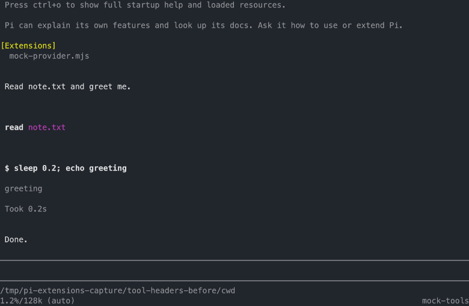
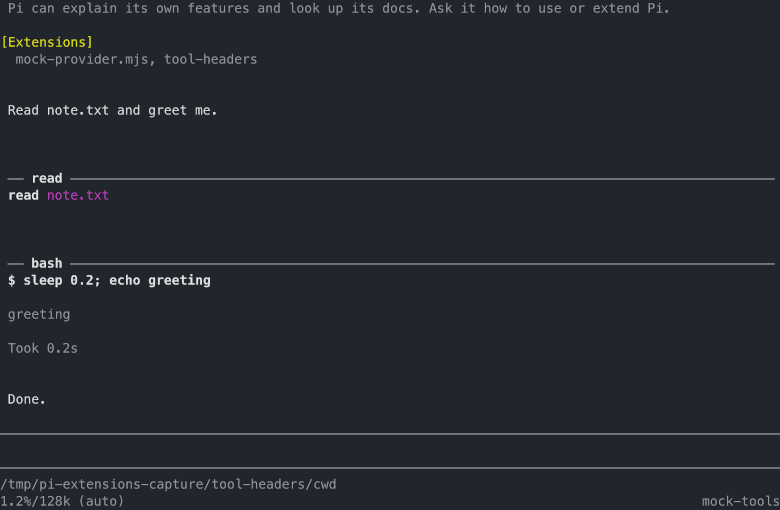

# tool-headers extension

Every Tool row sits in the same colored block, and the block says nothing
about which tool it holds. A `bash` and a `powershell` row print only
`$ <command>`; a `codemode` row prints a JSON blob; a `bash` and a `bash_bg`
row are identical in shape. This extension draws one line above each row's
call line - the **Tool row header**: the tool name set in a rule - so the
tool is told at a glance.

## Screenshot

The same session, once without the extension and once with it: the only
difference is the header line above each call line.

| Without tool-headers | With tool-headers |
| --- | --- |
|  |  |

## The header line

The header is the fieldset legend of the row: the tool name in the theme's
`toolTitle` (bold), set in a rule of `─` in `borderMuted`, running to the
right edge of the box's content area. It is always exactly one line. When the
width is tight, the rule shrinks to zero first (`── <name>`); only if the name
alone no longer fits is the name truncated, ending in `…`. The name is the
payload, so it truncates last.

```
(blank)
  ── read ──────────────────────────────────────────────────────────
  read src/auth/session.ts (1-40)
  42 lines
(blank)
```

The header carries the tool name and nothing else: the call line below already
carries the argument, and the row's background already carries the pending,
success, and error states. The green box, its padding, and its state colors
are untouched - the header is one line added above the call line, inside pi's
own shell. The `edit` row is the exception to that last part: pi draws it in
a plain container with no box, so its header paints the state background
itself, and the blank padding line the box would have painted above it.
Keeping the padding line is what keeps the block tops uniform.

## Scope

The header lands on every Tool row: the built-ins (`read`, `bash`,
`powershell`, `edit`, `write`, `grep`, `find`, `ls`), this package's tools
(`codegraph_*`, `bash_bg`, `job_wait`, `job_status`, `skill`, `codemode`),
`tool_search`, and MCP tools. The rows that look alike today are exactly the
ones that carry the value:

- A `bash` row and a `bash_bg` row are identical in shape; the header is what
  finally tells one from the other. The `bash_bg` call line stays `$ <command>`
  with no background marker ([ADR 0024](/adr/0024-bash-bg-tool-row-shows-the-plain-command-line)).
- An MCP row's header shows `server/tool`, dropping pi's `mcp__` spelling, the
  same form the row's call line uses, so the two agree. Every other row shows
  the tool's raw name.
- A tool that ships no renderer of its own keeps its stock call line (the
  shape pi's fallback draws) and gains the header above it.

The `edit` row sets its own shell and draws its diff preview instead of the
green box; its header goes above that preview, inside the self shell.
Uniformity is the point: a row that skipped the header would be the row the
operator misreads.

## How it works

The mechanism is a `pi.registerToolRenderer()` resolver that calls `next()`
first and wraps whatever pi or another extension would draw, prepending the
header. Wrapping reaches built-in tools, this package's tools, and MCP tools
through one path, and it composes with pi's own MCP resolver and with
`bash_bg`'s renderer instead of shadowing either
([ADR 0038](/adr/0038-tool-row-headers-wrap-pi-tool-renderers)). The resolver
never registers a tool: it changes a picture, not an execution.

- A `next()` of `undefined` (a tool pi knows no renderer for) yields
  `undefined`, leaving the row exactly as pi draws it.
- The wrapper keeps pi's inner component in per-row state and hands it back as
  `context.lastComponent`, so pi's built-in renderers keep their caches: the
  `edit` diff preview, the `write` highlight, the `bash` timer and truncation
  footer all still update, and click-to-expand and inline images keep working.
- The renderer serves the interactive transcript and the HTML export alike;
  the header draws in both.

## Always on

The extension is always on, with no setting and no command. It is a rendering
opinion in a personal package; the way to opt out is to not load the file.
